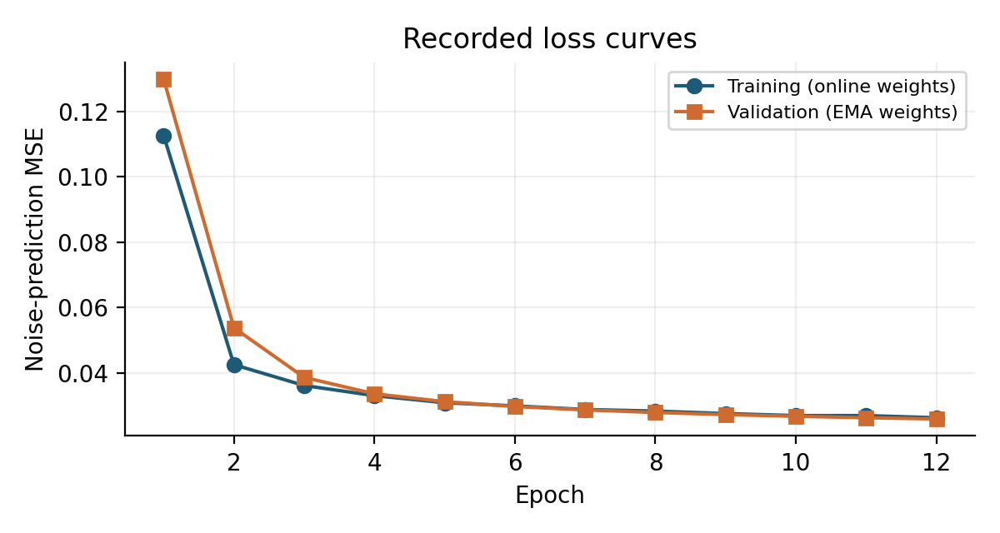
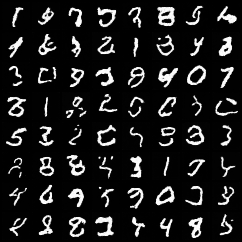
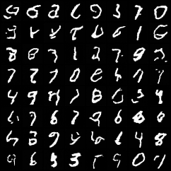
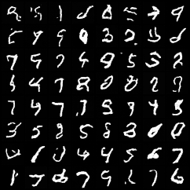
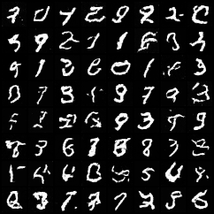

# mini-ddpm: MNIST diffusion from scratch

Fazal Hameed · CPU-compatible PyTorch · Recorded experiments on a free Colab T4

An implementation of DDPM forward noising, a time-conditioned U-Net trained
with noise-prediction MSE, reverse ancestral sampling and deterministic DDIM.
The U-Net has **550,465 parameters**, below the five-million-parameter limit.

The measured experiment trains one generator for 12 epochs, then compares
1,000-, 200- and 50-step DDPM sampling, plus the optional 50-step DDIM sampler.
Reduced-step samplers cover the original 1,000-step noise range with the correct
respaced posterior. They are not separately trained generators.

## Read the results

- [Three-page experimental report](Mini_DDPM_Report_Fazal_Hameed.pdf)
- [Runnable, self-contained Colab notebook](mini_ddpm_colab.ipynb)
- [Fixed experiment protocol](PROTOCOL.md)
- [Measured comparison (CSV)](comparison.csv) and [full metrics (JSON)](comparison.json)



| DDPM: 1,000 steps | DDPM: 200 steps |
|---|---|
|  |  |

| DDPM: 50 steps | DDIM: 50 steps |
|---|---|
|  |  |

## Download and run the complete project

[`Mini_DDPM_Fazal_Hameed.zip`](Mini_DDPM_Fazal_Hameed.zip) preserves the full
project layout: all PyTorch source, tests, final EMA generator and evaluation
classifier weights, configurations, losses, 512 unfiltered generated images per
setting, plots, metrics and report. Preview files beside the archive make the
main evidence readable directly on GitHub.

Extract the archive and run from its `mini-ddpm` directory:

```sh
python -m pip install -r requirements.txt
python test_ddpm.py
python sample.py --device cpu --method ddpm --steps 1000 --output ddpm_1000.png
python sample.py --device cpu --method ddpm --steps 200 --output ddpm_200.png
python sample.py --device cpu --method ddpm --steps 50 --output ddpm_50.png
python sample.py --device cpu --method ddim --steps 50 --output ddim_50.png
```

To retrain, use a fresh extracted folder and follow its README. The notebook
also embeds the exact source and training/evaluation commands for Colab.
No pretrained generator or diffusion framework is used. Raw MNIST dataset files
are downloaded with checksum verification and are not redistributed in the ZIP.

## Interpretation

Reported runtimes are GPU measurements, not laptop CPU timings. The classifier
feature distance is a 64-dimensional MNIST diagnostic, not standard Inception
FID. Classifier confidence on generated images is not generation accuracy.
One generator seed and 512 samples per setting limit general conclusions.

## References

- [DDPM](https://arxiv.org/abs/2006.11239), Ho, Jain and Abbeel (2020).
- [DDIM](https://arxiv.org/abs/2010.02502), Song, Meng and Ermon (2020).
- [Respaced posterior reference](https://github.com/openai/improved-diffusion/blob/main/improved_diffusion/respace.py).
- MNIST: LeCun, Cortes and Burges; source/checksums are documented in the project.

`SHA256SUMS` records uploaded artifact hashes. The archive is the authoritative
complete project, including the original directory structure needed by sampling.
